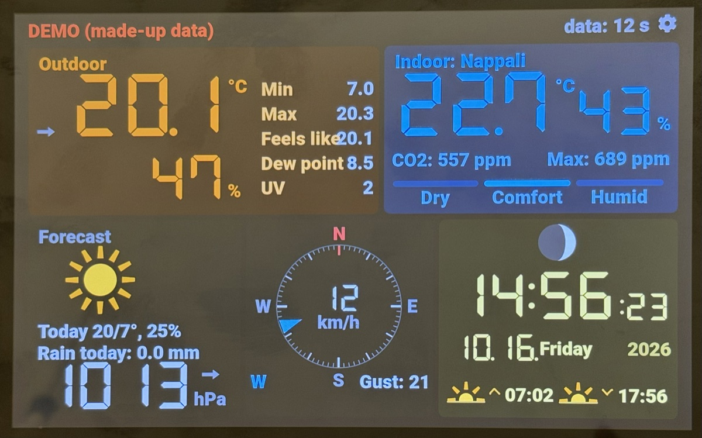
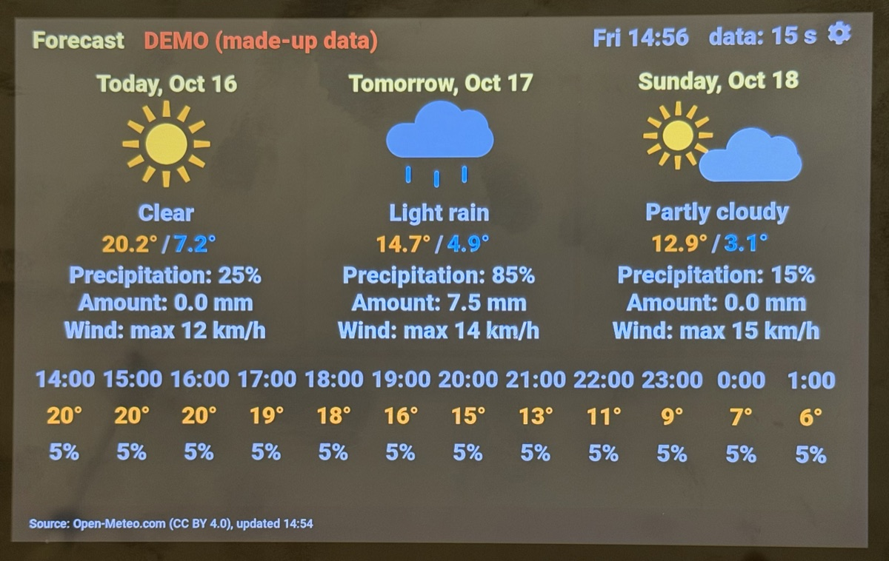
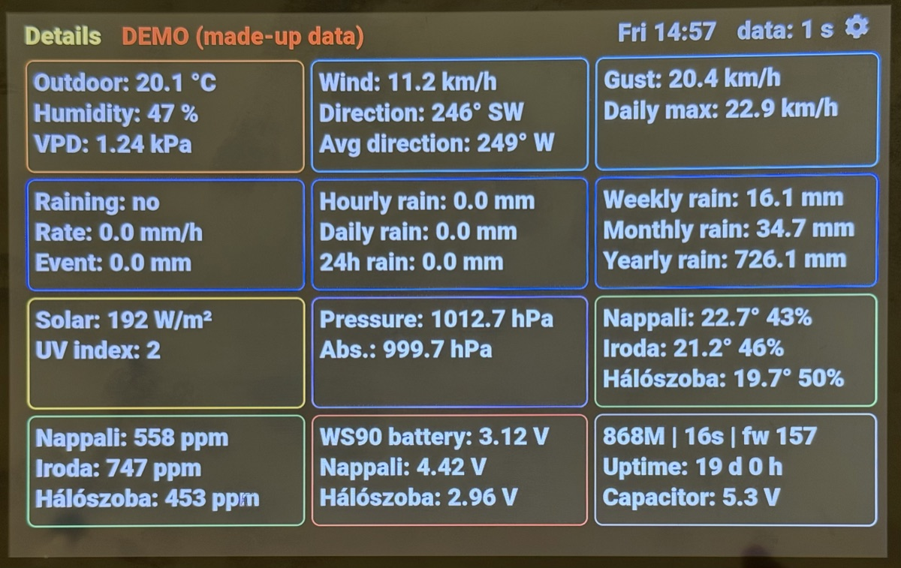
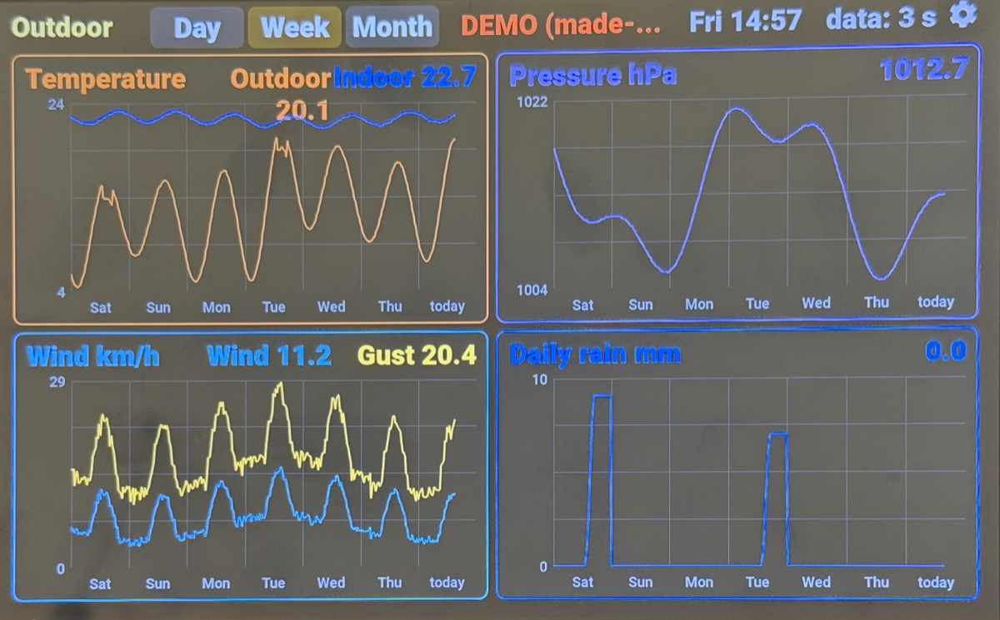
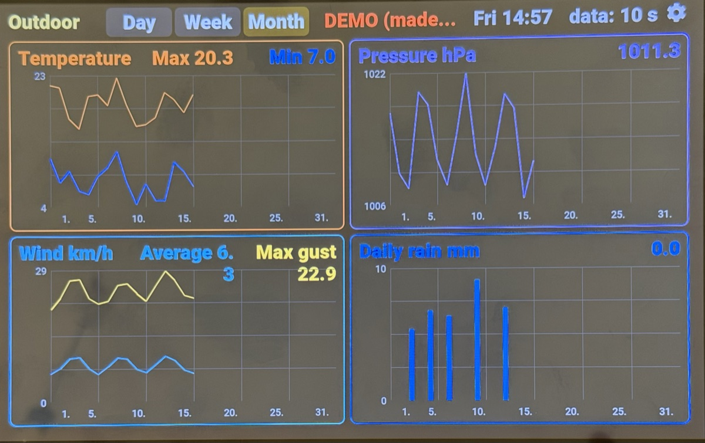
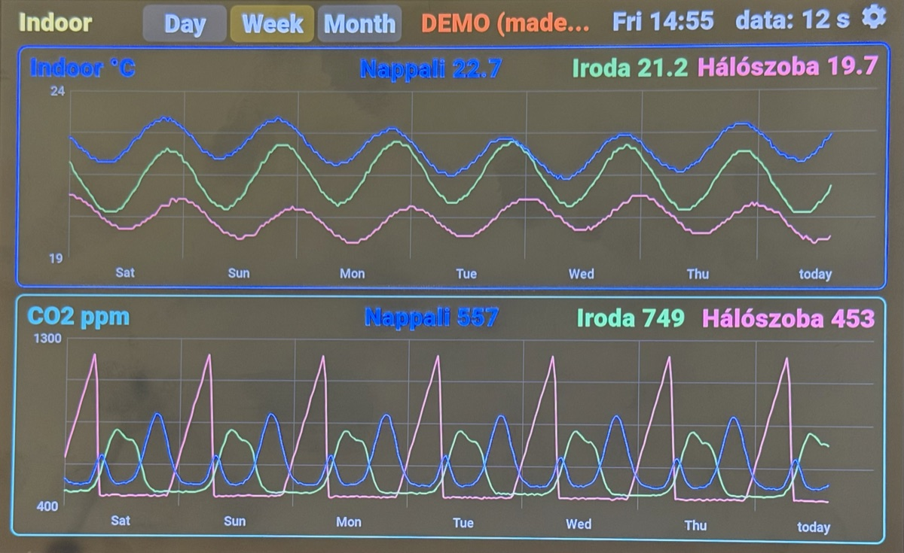
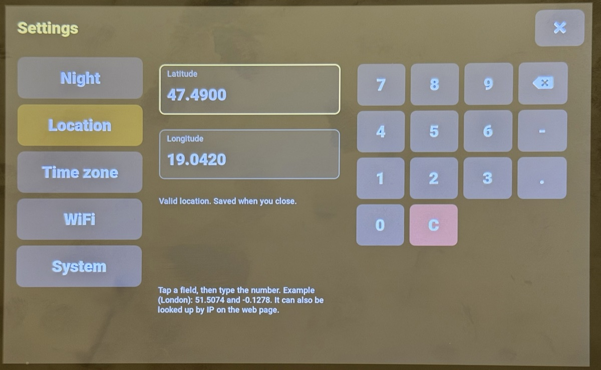
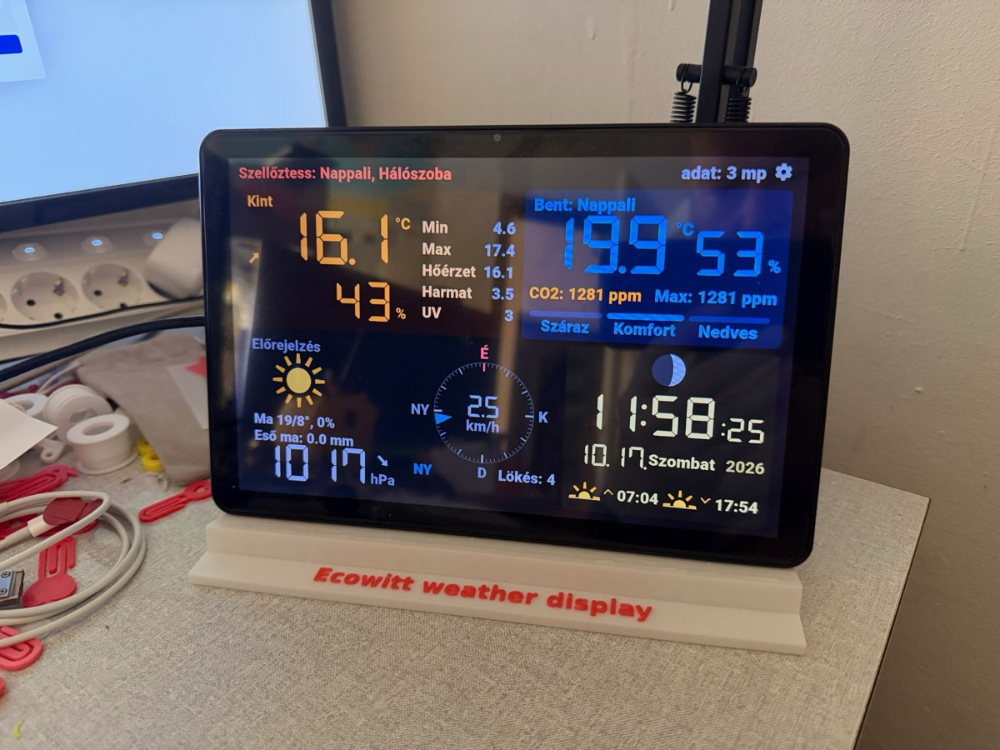

# Ecowitt Weather Display

**Weather display for Ecowitt stations** · *[Magyar változat](README.hu.md)*

A standalone touchscreen weather display for the ESP32. It receives data from Ecowitt consoles and gateways
("customized upload", Ecowitt protocol) directly on the local network – no cloud, no extra server – and shows a
dashboard, charts, a forecast, detailed readings and a log. It has its own web page (settings, OTA update,
diagnostics). The interface (display, web page, phone notifications) is available in English and Hungarian; English by default,
switchable on the device or on the web page.

The same code builds for two displays:

| Display | Chip | Resolution | PlatformIO environment |
|---|---|---|---|
| Waveshare ESP32-S3-Touch-LCD-7B (7") | ESP32-S3, 16 MB flash, 8 MB PSRAM | 1024x600, RGB | `idojaras` (default) |
| Guition JC8012P4A1C_I_W_Y (10.1") | ESP32-P4 + ESP32-C6 (WiFi) | 1280x800, MIPI-DSI | `idojaras_p4` |

## Screenshots

Photos of the display in demo mode (made-up data, English interface).



<table>
  <tr>
    <td width="50%"><br><sub>Forecast: 4 days and 24 hours</sub></td>
    <td width="50%"><br><sub>Details</sub></td>
  </tr>
  <tr>
    <td width="50%"><br><sub>Outdoor charts, week view</sub></td>
    <td width="50%"><br><sub>Outdoor charts, month view</sub></td>
  </tr>
  <tr>
    <td width="50%"><br><sub>Indoor temperature and CO2 per room, week view</sub></td>
    <td width="50%"><br><sub>On-device settings: location</sub></td>
  </tr>
</table>

## Features

**On the display**
- **Dashboard:** outdoor and indoor temperature, humidity (dry / comfortable / humid), CO2, wind compass with gusts,
  rain, pressure, UV, solar radiation, clock, sunrise/sunset, moon phase, short forecast.
- **Forecast:** 4 days and 24 hours from [Open-Meteo](https://open-meteo.com/) (no API key, only a location).
- **Charts:** temperature, pressure, wind, rain, indoor temperature and CO2 in day, week (7 days of 5-minute samples)
  and month (400-day daily summary) views; the outdoor minimum and maximum of the shown period are marked on the
  temperature chart; tap for full screen.
- **Details** and **Log** pages.
- **Energy** (optional, off by default): a HomeWizard P1 meter (grid), a HomeWizard Energy Socket (e.g. a water heater)
  and a Growatt solar plant. A power-flow diagram (moving dots show the direction: import purple, export green), today's
  import / export and heater consumption, voltage and current of the three phases, and a 24-hour chart of production,
  own use and grid import. Set up on the web page; the Growatt token is entered on one display only, which forwards
  the solar data to the others (Growatt rejects frequent requests).
- **Several rooms:** indoor data of up to 3 consoles (e.g. WS3910, GW3000, WN1821) shown separately; outdoor data
  (e.g. WS90) comes from the first one, from the others only if the first is silent for 2 minutes.
- **Colour warnings:** frost, heat, strong gusts, high UV, high CO2 ("ventilate"), low batteries, stale data.
- **Night mode:** dimmed display by clock or from sunset to sunrise; a touch lights it up briefly.
- **On-device settings** (gear icon): location, time zone, WiFi, brightness, language, restart, demo mode.
- **Demo mode:** realistic made-up data and automatic page cycling without consoles or WiFi (for exhibitions). It does
  not touch the real history.

**Network**
- **WiFi setup network** when there is no connection (`Weather-Setup`, on the P4 `Weather-Setup-P4`): the phone opens the
  setup page by itself; the display shows the steps with two QR codes and stays usable (demo mode one tap away).
  The network can later be changed or forgotten on the web page and on the display as well.
  In mesh networks it connects to the strongest access point.
- **Web page** (`http://idojaras.local/`, on the P4 `http://idojaras-p4.local/`): settings, OTA update, raw console
  data, diagnostics (reset reasons, crash summary), optional password.
- **Phone notifications** via [ntfy.sh](https://ntfy.sh/) (free, no sign-up): frost, rain, ventilation, low battery,
  stale data, crash; each can be switched on or off.
- **Forwarding to other displays:** consoles usually upload to a single address; the display can forward the
  received data to another one (up to 3 hops in a chain).
- **Screenshot:** `http://<display>/screenshot` returns the current screen as a BMP; `?oldal=energia` (or `fooldal`,
  `elorejelzes`, `kint`, `bent`, `reszletes`, `naplo`) switches to that page first; `&szoba=bedroom` (the room's name, accents
  optional, or its number: 1..3) sets the room on the dashboard's indoor card. It freezes the display for a few seconds.

**P4 only:** the board's RTC (RX8025T with coin cell) keeps time without WiFi; the Li battery voltage is shown and a
notification is sent on power loss; a sound alert when "ventilate" appears (on/off, volume; silent during the night
mode period); **automatic brightness with the built-in camera**: the display follows the room's light, dims when
nobody has moved in front of it for 10 minutes and wakes up on movement (the image never leaves the board and is
not saved; on/off on the web page).

## Requirements

- One of the two displays above.
- An Ecowitt console or gateway with "customized upload" (Ecowitt protocol), e.g. WS3910, GW3000, WN1821, with an
  outdoor sensor such as the WS90. Other Ecowitt devices may work if they send the same fields (the raw data of each
  console is shown on the `/raw` page).
- 2.4 GHz WiFi.

## Desk stand

A 3D-printable desk stand for the Guition JC8012P4A1C (10.1"):
[Desk Stand for Guition JC8012P4A1C 10.1" ESP32-P4 Display](https://makerworld.com/hu/models/3451581-guition-jc8012p4a1c-10-1-desk-stand) on MakerWorld. The STL is also in this repository:
[docs/desk-stand/desk-stand-ecowitt.stl](docs/desk-stand/desk-stand-ecowitt.stl).



## Installing without building

Ready-made firmware files are attached to each [release](https://github.com/losy58/Ecowitt-Weather-Display/releases/latest):

| File | Display | Use |
|---|---|---|
| `…-7B-factory.bin` | Waveshare 7B (ESP32-S3) | first installation over USB, at address `0x0` |
| `…-P4-factory.bin` | Guition JC8012P4A1C (ESP32-P4) | first installation over USB, at address `0x0` |
| `…-7B-ota.bin` | Waveshare 7B | update of a running display on its web page (*Firmware frissítés*) |
| `…-P4-ota.bin` | Guition JC8012P4A1C | update of a running display on its web page (*Firmware frissítés*) |

**First installation** (USB cable to the display's USB port):
- easiest: open the **[web installer](https://losy58.github.io/Ecowitt-Weather-Display/)** in Chrome or Edge and click *Install*; it picks the right firmware
  for the display automatically;
- or in the browser with [ESP Tool](https://espressif.github.io/esptool-js/) in Chrome
  or Edge, *Connect*, choose the display's port, add the `factory.bin` file at flash address **`0x0`**, *Program*;
- or with [esptool](https://docs.espressif.com/projects/esptool/): `esptool --chip esp32s3 write-flash 0x0 <file>`
  (7B) or `esptool --chip esp32p4 write-flash 0x0 <file>` (P4).

The `factory.bin` also clears the stored settings (WiFi, location, …): use it only for the first installation. (On the
P4 the WiFi network is stored by the WiFi chip and stays; to clear it: Settings / WiFi / Forget WiFi.) Then
continue with [Setup](#setup). **Updates** keep everything: upload the `ota.bin` on the display's web page.

The P4 firmware is built for ESP32-P4 chip revision v3 (tested on v3.2; older revisions may not run it) and expects
the factory firmware of the board's ESP32-C6 WiFi chip.

## Building

Build the final firmware **with PlatformIO**: `platformio.ini` contains ESP-IDF settings (`custom_sdkconfig`) without
which the picture shifts or flashes during flash writes (saving, OTA).

1. Install [PlatformIO Core](https://platformio.org/install/cli) (or the VS Code extension).
2. Clone the repository. The library (LVGL 9.6.0) is downloaded by PlatformIO on the first
   build.
3. Build and upload over USB:
   ```
   pio run -t upload                     # Waveshare 7B (ESP32-S3)
   pio run -e idojaras_p4 -t upload      # Guition JC8012P4A1C (ESP32-P4)
   pio device monitor                    # serial log, 115200 baud
   ```

The first build takes several minutes because the framework is recompiled; this repeats when switching between the
two environments. The platform is pinned: pioarduino, Arduino-ESP32 3.3.12 / ESP-IDF 5.5.5.

Later updates can go over the air: upload `.pio/build/<environment>/firmware.bin` on the web page.

> Changing `partitions.csv` (2 x 3 MB OTA app + FFat + coredump) breaks OTA and loses the stored history.

## Setup

1. **WiFi:** on first start the display opens its own access point; connect with a phone and choose your network.
   The display then shows its IP address.
2. **Location and time zone:** on the display (gear icon) or on the web page. Without a location there is no
   sunrise/sunset and no forecast (it can also be looked up by IP).
3. **Consoles** (Ecowitt / WS View Plus app, *Weather Services → Customized*):
   - protocol: **Ecowitt**
   - server: the display's IP address (a fixed IP from the router is recommended)
   - path: **`/ecowitt`**, port: **80**
   - upload interval: e.g. 16-60 s
4. **Rooms** on the web page: for each room a name, the console's identifier (searched in the `model` or `stationtype`
   field, e.g. `WS3910`) and a low battery voltage limit. Incoming senders and their identifiers are listed on `/raw`.
5. Optionally: web page password (user name: `admin`), night mode, ntfy topic, forwarding.

## Web endpoints

| Path | Description |
|---|---|
| `/`, `/update` | web page, settings, OTA update |
| `/raw` | all fields of each console's last upload |
| `/ecowitt` | data from the consoles (`?fwd=N`: forwarded data, forwarded at most 3 times) |
| `/energia` | solar data forwarded from another display (POST) |
| `/screenshot` | the current screen as a BMP (`?oldal=<page>` switches to a page first, `&szoba=<room>` sets the dashboard's room) |
| `/settings`, `/wifiscan`, `/wifiset`, `/wifistatus`, `/wifiportal`, `/wififorget`, `/ntfytest`, `/clearcrash` | web page actions |

Without a password anyone on the local network can reach the web page. Do not expose the display directly to the
internet.

## Code structure

A single Arduino sketch split into `.ino` files by topic; the Arduino IDE and PlatformIO concatenate them in
alphabetical order into one translation unit, so the numbering defines the order. Source comments and identifiers are
in Hungarian.

| File | Content |
|---|---|
| `idojaras.ino` | includes, pins, data types, shared variables, tunable constants (thresholds, colours), settings |
| `energia_01_adatok.ino`, `energia_02_oldal.ino` | energy: HomeWizard / Growatt data in a background task, web settings, solar forwarding; the Energy page and its charts |
| `idojaras_02`…`_17g_*.ino` | display, time and brightness, history, forecast, dashboard, consoles, forwarding, charts, web, diagnostics, touch, settings, notifications, demo, RTC and battery, screenshot |
| `idojaras_18_setup_loop.ino` | UI construction, startup, main loop |
| `wifi_manager.cpp/.h` | WiFi connection and setup network |
| `kijelzo.h` | display selection, resolution, scaling macros (`SX`, `SY`, `S`) |
| `p4/` | P4 board display, touch and RTC handling, larger fonts |
| `font_*.c`, `lv_conf.h` | LVGL fonts (Roboto with Hungarian accents, seven-segment DSEG7) and LVGL configuration |

The program runs a single-threaded, non-blocking main loop (60 s watchdog); only the forecast download, ntfy
notifications, forwarding and the energy data run as background tasks. Settings are stored in NVS, history on FFat (`/hist.bin`,
`/days.bin`, `/energia.bin`). Detailed developer notes (in Hungarian): [CLAUDE.md](CLAUDE.md).

## Third-party components

| Component | Source | License |
|---|---|---|
| `p4/esp_lcd_jd9365.*`, `p4/esp_lcd_touch.*` | Espressif Systems | Apache-2.0 |
| `p4/gsl_point_id.*` | Silead Inc. | GPL-2.0-or-later |
| `p4/esp_lcd_touch_gsl3680.*` (with the GSL3680 controller firmware) | board vendor's example code | not stated |
| `font_hu_*`, `p4/font_hu_*` | [Roboto](https://fonts.google.com/specimen/Roboto) | Apache-2.0 / OFL-1.1 |
| `font_seg_*`, `p4/font_seg_*` | [DSEG7 Classic](https://github.com/keshikan/DSEG) | OFL-1.1 |
| LVGL (installed separately) | lvgl.io | MIT |
| `docs/esp-web-tools/` (web installer, own build with esptool-js 0.7.0) | [ESP Web Tools](https://github.com/esphome/esp-web-tools) | Apache-2.0 |

## License

[GNU General Public License v3.0](LICENSE) (GPL-3.0-or-later). You may use, modify and redistribute the program;
redistributed (modified) versions must also be published with source code under the same license.

Third-party files are covered by their own licenses (see above). The GSL3680 touch driver and its controller firmware
(`p4/esp_lcd_touch_gsl3680.*`) come from the board vendor's publicly available example code, which states no license;
they are included only so that the touch screen works. If the rights holder objects, they will be removed on request.

## Acknowledgements

Weather forecast: [Open-Meteo](https://open-meteo.com/) (CC BY 4.0). IP geolocation: ipwho.is.
